

  

  
  
  
  
  

 

  

 

  

 

  

  <a href="https://app.pxengine.ai"></a>

  <a href="https://awaiszahiddev.vercel.app"></a>
  <a href="https://awaiszahiddev.vercel.app"></a>

  <a href="https://awaiszahiddev.vercel.app"></a>
  <a href="https://awaiszahiddev.vercel.app"></a>

 

  

  
  

  

 

  <a href="mailto:zahidawais31@gmail.com"></a>

  
  
  

